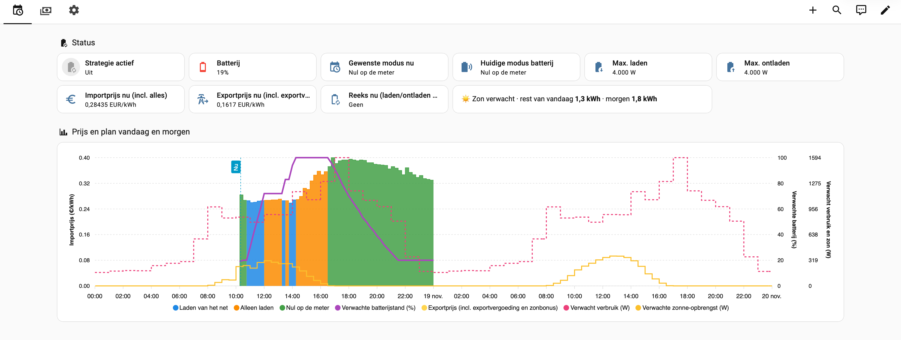
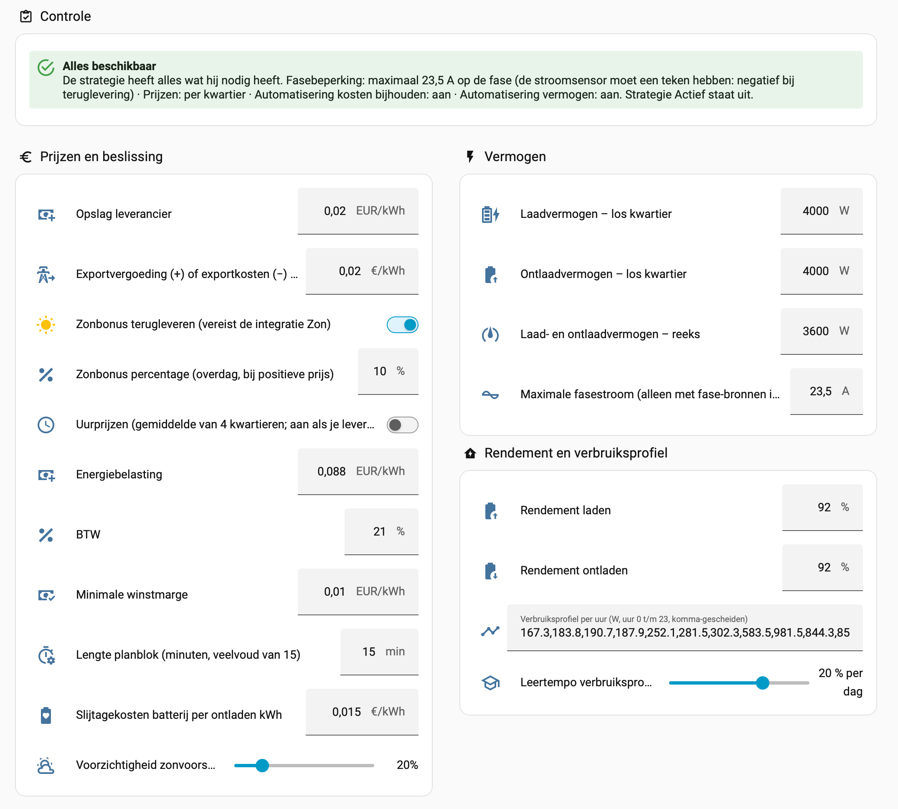
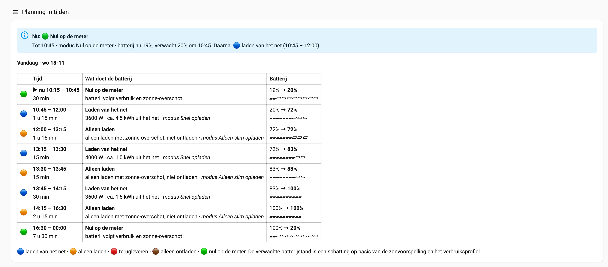
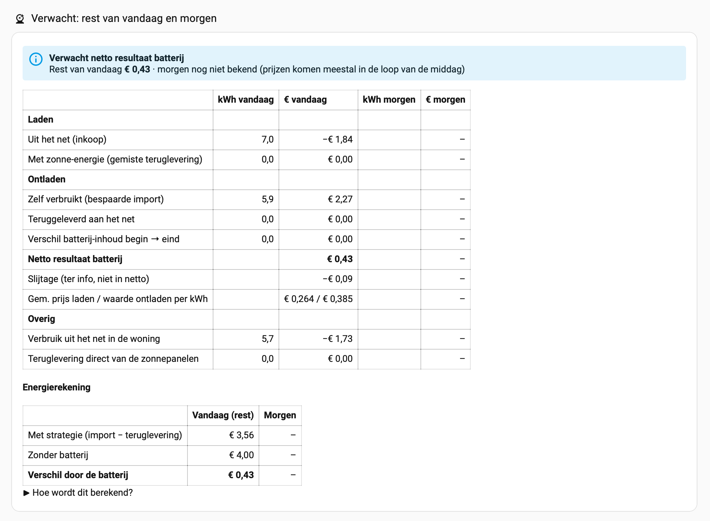
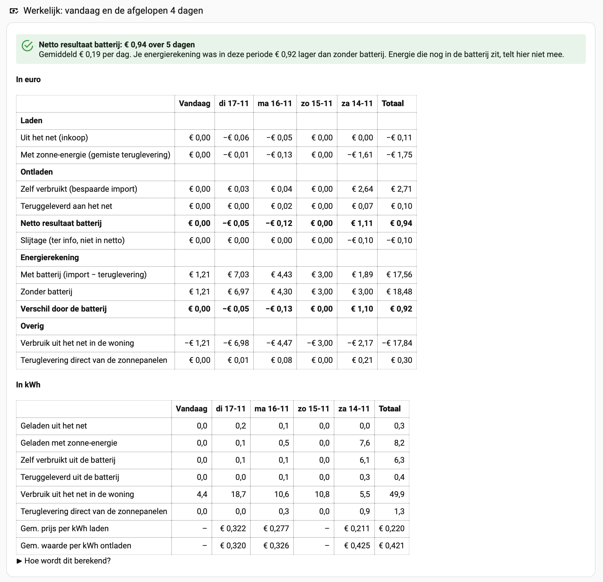

# Batterijstrategie voor Zendure-thuisbatterijen

Een slimme laad- en ontlaadstrategie voor Zendure-thuisbatterijen in Home Assistant, gebouwd op het Zendure-pakket van Gielz. De strategie werkt met de entiteiten van dat pakket (`zendure_2400_ac_…`). De strategie kijkt naar de dynamische stroomprijzen van vandaag en morgen, de zonvoorspelling en je eigen verbruikspatroon. Daarmee kiest hij per kwartier (of per blok) wat de batterij het beste kan doen, en zet de Gielz-modus daarop.

Versie: 18 november 2026.



---

## Inhoud van het pakket

De bestanden staan in twee mappen: [`basismodule/`](basismodule) met de bestanden die iedereen nodig heeft, en [`optionelemodules/`](optionelemodules) met per optie een eigen map.

```
basismodule/
  batterijstrategie.yaml                 pakket met alle rekensensoren, instellingen en opslag
  automatisering_modus_sturen.yaml       zet de Gielz-modus volgens het plan
  automatisering_verbruik_meten.yaml     meet elk kwartier en leert je verbruiksprofiel
  batterijstrategie_dashboard.yaml       dashboard met planning, kosten, instellingen en controle
optionelemodules/
  kosten-bijhouden/
    automatisering_kosten_bijhouden.yaml houdt de werkelijke kosten en opbrengst bij
  reeks-en-fasebeperking/
    batterijstrategie_reeks.yaml         eigen vermogensplafonds, reeksvermogen en fasebeperking
    automatisering_vermogen.yaml         stuurt het laad- en ontlaadvermogen (hoort bij het bestand hierboven)
```

Het dashboard is nodig omdat je daar de instellingen invult en het blok Controle laat zien of alles klopt. De optionele mappen staan beschreven onder [Optionele modules](#optionele-modules).

---

## Vereisten

- **Home Assistant 2026.10 of nieuwer.** Het dashboard gebruikt zichtbaarheidsvoorwaarden met een template.
- **Het Zendure-pakket van Gielz, in de Nederlandse versie**, werkend en ingesteld. De strategie gebruikt de Nederlandse entiteitsnamen van dat pakket. Die zijn voor alle Zendure-modellen die Gielz ondersteunt hetzelfde (`zendure_2400_ac_…`), dus de strategie werkt ook met andere modellen, zolang die via Gielz lopen. Met de Engelse versie van Gielz werkt de strategie niet. De strategie gebruikt onder andere deze entiteiten:
  - `input_select.zendure_2400_ac_modus_selecteren`, `sensor.zendure_2400_ac_laadpercentage`
  - `sensor.zendure_2400_ac_indicatie_benodigde_energie` (attribuut `totale_capaciteit_kwh`)
  - `input_number.zendure_2400_ac_minimaal_toegestaan_laadpercentage`, `…_maximaal_toegestaan_laadpercentage`
  - `input_number.zendure_2400_ac_max_oplaadvermogen`, `…_max_ontlaadvermogen`
  - `sensor.zendure_2400_ac_energie_import`, `…_energie_export`
  - `input_text.dynamisch_nordpool_sensor` (welke Nordpool-sensor Gielz gebruikt)
- **Nordpool (HACS)**: de sensor uit `input_text.dynamisch_nordpool_sensor`, met de attributen `raw_today`, `raw_tomorrow` en `tomorrow_valid`. Kale marktprijs, zonder btw.
- **Een P1-meter** met de totale afname en teruglevering als meterstand (Wh, kWh of MWh).
- **Optioneel:**
  - Solcast, voor de zonvoorspelling. Gebruikt het attribuut `detailedForecast`.
  - Een meterstand van de zonne-opbrengst.
  - De integratie **Zon** (`sun.sun`), alleen nodig als je de zonbonus aanzet.
- **apexcharts-card** (HACS of Marketplace), voor de grafiek op het dashboard.

---

## Installatie op een verse installatie

### 1. Packages aanzetten

Staat dit nog niet in `configuration.yaml`, voeg het dan toe en herstart Home Assistant één keer:

```yaml
homeassistant:
  packages: !include_dir_named packages
```

### 2. Het pakket plaatsen en je bronnen invullen

Zet `basismodule/batterijstrategie.yaml` in `/config/packages/` in Home Assistant (het bestand zelf, niet de map). Open het bestand en vul **alleen** het blok `Strategie bronnen` in, direct onder `template:`:

| Bron | Wat | Voorbeeld | Leeg laten mag? |
|---|---|---|---|
| `zon_vandaag` | Solcast-voorspelling van vandaag | `sensor.solcast_pv_forecast_forecast_today` | Ja. Leeg = geen zonnepanelen, dan rekent hij met zon = 0 |
| `zon_morgen` | Solcast-voorspelling van morgen | `sensor.solcast_pv_forecast_forecast_tomorrow` | Ja (zie hierboven) |
| `zon_opbrengst` | Meterstand van de totale zonne-opbrengst | `sensor.envoy_123456789012_lifetime_energy_production` (Enphase Envoy) | Ja, dan telt de opbrengst als 0 |
| `net_verbruik` | Meterstand van de totale afname van het net (P1) | `sensor.p1_meter_3c39e7000000_totaal_verbruik` (HomeWizard P1) | Nee |
| `net_teruglevering` | Meterstand van de totale teruglevering aan het net (P1) | `sensor.p1_meter_3c39e7000000_totaal_teruglevering` (HomeWizard P1) | Nee |

De precieze namen verschillen per installatie: ze bevatten bijvoorbeeld het serienummer van je apparaat, en hangen af van de taal van je Home Assistant. Een Engelstalige installatie geeft bij de Solcast-integratie bijvoorbeeld `…_forecast_today`, een Nederlandstalige `…_voorspelling_vandaag`. Zoek de juiste naam op via **Instellingen > Apparaten en diensten > Entiteiten**. Gebruik bij de meterstanden een sensor in Wh, kWh of MWh, geen vermogen in W.

Ingevuld ziet het blok er bijvoorbeeld zo uit:

```yaml
  - sensor:
      - name: "Strategie bronnen"
        unique_id: strategie_bronnen
        icon: mdi:database-cog
        state: "ok"
        attributes:
          zon_vandaag: sensor.solcast_pv_forecast_forecast_today
          zon_morgen: sensor.solcast_pv_forecast_forecast_tomorrow
          zon_opbrengst: sensor.envoy_123456789012_lifetime_energy_production
          net_verbruik: sensor.p1_meter_3c39e7000000_totaal_verbruik
          net_teruglevering: sensor.p1_meter_3c39e7000000_totaal_teruglevering
```

Zonder zonnepanelen laat je de drie zon-regels leeg (`zon_vandaag: ""` enzovoort).

Herlaad daarna **Ontwikkelaarshulpmiddelen > YAML > Alle YAML-configuratie**.

### 3. Het dashboard toevoegen

1. Ga naar **Instellingen > Dashboards > Dashboard toevoegen > Nieuw dashboard vanaf nul**.
2. Open het nieuwe dashboard en kies rechtsboven **⋮ > Bewerken > ⋮ > Ruwe configuratie-editor**.
3. Vervang alles door de inhoud van `basismodule/batterijstrategie_dashboard.yaml` en sla op.

### 4. De instellingen invullen

Vul op het tabblad **Instellingen** van het dashboard de instellingen in (zie [Instellingen](#instellingen)). Er staan geen beginwaarden in: een nieuwe instelling start op haar minimum. Het blok **Controle** bovenaan meldt welke instellingen nog op het minimum staan.

### 5. De automatiseringen toevoegen

Ga voor elk bestand naar **Instellingen > Automatiseringen > Automatisering maken > Nieuwe automatisering > ⋮ > Bewerken in YAML**, vervang alles door de inhoud van het bestand en sla op:

1. `basismodule/automatisering_modus_sturen.yaml`
2. `basismodule/automatisering_verbruik_meten.yaml`
3. Optioneel: `optionelemodules/kosten-bijhouden/automatisering_kosten_bijhouden.yaml`

Het verbruiksprofiel begint leeg. Bij het eerste gemeten kwartier vult *Verbruik meten en bijleren* het profiel, en daarna leert het elk kwartier bij.

### 6. Controleren en aanzetten

Open het tabblad **Instellingen**. Het blok **Controle** controleert:
- je bronnen, met de juiste eenheden;
- de Nordpool-sensor;
- de rekensensoren;
- het verbruiksprofiel;
- de automatiseringen.

Zet **Strategie Actief** pas aan als er geen rode melding meer staat. Zolang de schakelaar uit staat, rekent alles mee, maar verandert er niets aan je batterij. De enige uitzondering is de fasebewaking van de aanvulling reeks, als je die gebruikt.



---

## Zo werkt het

```
Nordpool ─► Prijzen ─┐
Solcast  ─► Invoer ──┼─► Planner ─► Plan ─► Simulatie ─► Gewenste modus ─► Modus sturen ─► Gielz
Profiel  ─►──────────┘      ▲                                                  │
                            └──── batterijstand, instellingen ─────────────────┘
P1 / Zendure / zon ─► Verbruik meten ─► Verbruiksprofiel (en Kosten bijhouden)
```

1. **Prijzen** (`sensor.strategie_prijzen`) rekent per kwartier voor vandaag en morgen de importprijs en exportprijs uit:
   - **Import:** (kale prijs + opslag + energiebelasting) × (1 + btw).
   - **Export:** kale prijs + exportvergoeding. Overdag en bij een positieve prijs komt daar eventueel de zonbonus bij.

   Alle andere onderdelen lezen hun prijzen uit deze ene sensor.
2. **Invoer** (`sensor.strategie_invoer`) geeft per kwartier de verwachte zonopbrengst (Solcast) en het verwachte huisverbruik (het verbruiksprofiel), tot het eind van morgen. De planner gebruikt alleen de kwartieren waarvoor al prijzen zijn; de rest is voor de grafiek en de zonverwachting van morgen.
3. **Planner** (`sensor.strategie_plan`) zoekt per planblok de goedkoopste keuze tot het eind van de bekende prijzen. Hij weegt daarbij het rendement, de slijtage, de minimale winstmarge en de waarde van de energie die aan het eind nog in de batterij zit. Per blok kiest hij één van vijf acties:

   | Letter | Gielz-modus | Wat de batterij doet |
   |---|---|---|
   | N | Nul op de meter | Volgt verbruik en zonne-overschot |
   | H | Alleen slim opladen | Laadt alleen met zonne-overschot, ontlaadt niet |
   | O | Alleen slim ontladen | Dekt alleen het tekort, zonne-overschot gaat naar het net |
   | C | Snel opladen | Laadt uit het net |
   | X | Snel ontladen | Levert terug aan het net, en houdt 5% reserve |

   Het lopende blok telt alleen de tijd die nog over is. Bij blokken van 30 minuten of korter worden losse blokken N, H of O tussen twee gelijke buren gladgestreken. Zo wisselt de batterij niet voor een paar tienden van een cent van modus.
4. **Simulatie** (`sensor.strategie_simulatie`) rekent het plan kwartier voor kwartier door. Dat geeft de verwachte batterijstand en de energiestromen, die het dashboard toont.

   

5. **Gewenste modus** (`sensor.strategie_gewenste_modus`) geeft de Gielz-modus voor het huidige kwartier. Is de batterij vol tijdens een laadkwartier, dan wordt dat *Alleen slim opladen*. Zit de batterij op de reserve tijdens een ontlaadkwartier, dan wordt dat *Nul op de meter*.
6. **Modus sturen** zet de Gielz-modus, maar alleen met Strategie Actief aan. Valt het plan 5 minuten weg, of zijn de prijzen of het plan 16 minuten of langer niet bijgewerkt, dan gaat de batterij terug naar Nul op de meter.
7. **Verbruik meten en bijleren** leest elk kwartier de meterstanden van de P1-meter, de Zendure en de zonnemeter. Daaruit rekent het het huisverbruik uit, en schuift het verbruiksprofiel van dat uur een stukje richting de meting.
   - **Meter springt terug of te ver vooruit:** springt een meterstand van de P1 of de Zendure terug, of meer dan 10 kWh vooruit, dan telt dat kwartier niet mee.
   - **Haperende zonnemeter:** telt het zonverschil als 0, en de zon volgt dan uit de netbalans.

**Geen terugvalwaarden.** Ontbreekt een prijs, invoer of instelling, dan wordt een sensor *niet beschikbaar*; er wordt niet met een aangenomen waarde gerekend. Twee voorbeelden:
- Een ingevulde Solcast-sensor zonder voorspelling maakt de invoer niet beschikbaar. Het plan rekent dan niet ongemerkt zonder zon.
- Modus sturen zet de batterij daarna veilig op Nul op de meter.

---

## Instellingen

Allemaal op het tabblad **Instellingen** van het dashboard.

| Instelling | Betekenis |
|---|---|
| Opslag leverancier | Opslag per kWh bovenop de kale prijs, zonder btw |
| Energiebelasting | Energiebelasting per kWh, zonder btw |
| BTW | Btw-percentage over import |
| Exportvergoeding | Vergoeding (+) of kosten (−) per teruggeleverde kWh |
| Zonbonus terugleveren / percentage | Extra percentage op de exportprijs overdag bij een positieve prijs (optioneel, zie hieronder) |
| Uurprijzen | Rekenen met het uurgemiddelde (optioneel, zie hieronder) |
| Minimale winstmarge | Wat laden uit het net minimaal moet opleveren per kWh |
| Lengte planblok | 15 tot 120 minuten, in stappen van 15. De planner kiest één actie per blok, gerekend vanaf middernacht (bij 60 minuten: hele klokuren) |
| Slijtagekosten | Kosten per ontladen kWh |
| Voorzichtigheid zonvoorspelling | 0% = middenschatting (P50) van Solcast, 100% = pessimistisch (P10) |
| Rendement laden / ontladen | Verlies bij laden en ontladen |
| Leertempo verbruiksprofiel | Hoe snel het profiel zich aanpast (% per dag; 0 = niet bijleren) |
| Vermogen (alleen met de aanvulling reeks) | Laad- en ontlaadvermogen los kwartier, reeksvermogen en maximale fasestroom (zie *Aanvulling reeks en fasebeperking*). Zonder de aanvulling rekent de planner met het max. oplaad- en ontlaadvermogen dat je in Gielz instelt |

---

## Optionele modules

### Kosten bijhouden

Map: [`optionelemodules/kosten-bijhouden/`](optionelemodules/kosten-bijhouden)

`automatisering_kosten_bijhouden.yaml` telt elk kwartier de werkelijke energiestromen op en waardeert ze tegen de prijs van dat kwartier:
- laden uit het net;
- laden met zon;
- ontladen voor het huis;
- terugleveren;
- verbruik uit het net.

Het resultaat staat op het tabblad **Kosten**, in het blok *Werkelijk*, voor vandaag en de vier dagen daarvoor. De automatisering verandert niets aan de batterij. Zonder deze automatisering werkt de strategie gewoon. Het blok *Werkelijk* meldt dan dat de kosten niet worden bijgehouden; de verwachting voor vandaag en morgen blijft wel zichtbaar. Staat de automatisering wel in Home Assistant maar is hij uitgezet, dan toont het blok *Werkelijk* een oranje melding dat de cijfers niet meer worden bijgewerkt, en het blok Controle ook.

| Verwacht: rest van vandaag en morgen | Werkelijk: vandaag en de afgelopen 4 dagen |
|---|---|
|  |  |

### Aanvulling reeks en fasebeperking

Map: [`optionelemodules/reeks-en-fasebeperking/`](optionelemodules/reeks-en-fasebeperking)

Voor wie eigen vermogensplafonds wil, met een lager vermogen bij langere reeksen snel laden of ontladen en/of een begrenzing op de fasestroom.

**Wat het toevoegt**
- **Plafonds:** een laadvermogen en ontlaadvermogen voor een los kwartier.
- **Reeksvermogen:** het vermogen bij een reeks van twee of meer kwartieren snel laden of ontladen.
- **Fase-bronnen:** de stroom (A) en spanning (V) van de fase waar de batterij op zit.
- **Maximale fasestroom:** de maximale stroom op die fase, in te stellen op het dashboard.
- **De automatisering *vermogen*:** stuurt het max. oplaad- en ontlaadvermogen van Gielz.

**Installeren**
1. Zet `batterijstrategie_reeks.yaml` uit deze map naast `batterijstrategie.yaml` in `/config/packages/`. Vul de fase-bronnen in, of laat ze allebei leeg als je geen fasebegrenzing wilt. Bijvoorbeeld met een HomeWizard P1, met de batterij op fase 1:

   ```yaml
           attributes:
             stroom: sensor.p1_meter_3c39e7000000_actuele_stroom_fase_1
             spanning: sensor.p1_meter_3c39e7000000_actuele_spanning_fase_1
   ```
2. Herlaad **Alle YAML-configuratie** en vul op het tabblad Instellingen, onder *Vermogen*, de plafonds, het reeksvermogen en de maximale fasestroom in (bijvoorbeeld 23,5 A bij een zekering van 25 A). De maximale fasestroom staat na installatie op het minimum van 6 A.
3. Voeg daarna pas `automatisering_vermogen.yaml` toe.

**Hoe het werkt**
- **Aanvulling herkend:** zodra `input_number.strategie_vermogen_bij_reeks` bestaat, rekent de planner met je plafonds en het reeksvermogen in plaats van met het vermogen van Gielz. Het dashboard toont dan ook de reeks en het blok *Vermogen* bij Instellingen; zonder de aanvulling is dat blok verborgen.
- **Strategie aan:**
  - het oplaadvermogen volgt het plafond, tijdens een laadreeks het reeksvermogen;
  - het oplaadvermogen wordt verlaagd zodra de fasestroom boven het maximum komt;
  - het ontlaadvermogen volgt het plafond, tijdens een ontlaadreeks het reeksvermogen.
- **Strategie uit:** alleen fasebewaking. Wordt de fasestroom te hoog, dan onthoudt hij het oplaadvermogen van dat moment en verlaagt hij het. Is er weer ruimte, dan zet hij het terug naar de onthouden waarde. Verder blijft hij eraf.
- **Fasemeting niet bruikbaar** (bijvoorbeeld de P1 even weg): hij verlaagt alleen nog, en verhoogt nooit. Er wordt dus nooit voluit geladen zonder fasebewaking.
- **Handmatig wijzigen:** zet je het max. oplaadvermogen van Gielz met de hand, dan wordt die waarde het nieuwe plafond.

> **Let op:** de stroomsensor moet een teken hebben: positief bij afname, negatief bij teruglevering (zoals de HomeWizard P1). Zonder teken knijpt hij het laden juist af als er veel zon wordt teruggeleverd.

**Logboek:** de automatisering *vermogen* draait elke 5 seconden. `batterijstrategie_reeks.yaml` haalt zijn "triggered"-regels daarom uit het logboek (`logbook: exclude:`), zodat je alleen ziet wanneer hij echt iets verandert. Dat werkt pas na een herstart van Home Assistant. Heb je in je `configuration.yaml` al een `logbook:`-blok met `exclude`, dan is dat geen probleem: Home Assistant voegt de lijsten samen. Daar kun je ook andere automatiseringen bijzetten die elke paar seconden draaien, zoals `automation.zendure_zensdk_gielz`.

**Verwijderen:** haal `batterijstrategie_reeks.yaml` weg, herlaad alle YAML en verwijder de automatisering *vermogen*. De planner rekent dan weer met het vermogen van Gielz.

### Zonbonus

Sommige leveranciers geven overdag, bij een positieve prijs, een extra percentage op teruglevering. Zet **Zonbonus terugleveren** aan en vul het percentage in. Daarvoor is de integratie **Zon** (`sun.sun`) nodig, voor zonsopkomst en -ondergang. Ontbreekt die integratie terwijl de zonbonus aan staat, dan meldt het blok Controle dat in rood. Bij een nieuwe installatie staat de zonbonus uit.

### Uurprijzen

Rekent je leverancier af per uur in plaats van per kwartier? Zet dan **Uurprijzen** aan. Elk kwartier krijgt dan als kale prijs het gemiddelde van de vier kwartieren van zijn klokuur; opslag, belasting, btw en zonbonus gaan daar per kwartier overheen. Planner, simulatie, kosten en grafiek volgen vanzelf. Hoe vaak de planner een andere actie kiest, stel je los daarvan in met **Lengte planblok**.

---

## Entiteiten

| Entiteit | Inhoud |
|---|---|
| `sensor.strategie_bronnen` | Je ingevulde bronnen |
| `sensor.strategie_prijzen` | Import- en exportprijzen per kwartier, huidig kwartier (`kwartier_nu`) |
| `sensor.strategie_invoer` | Zon en verbruik per kwartier |
| `sensor.strategie_plan` | Plan: één letter per kwartier (`.` = voorbij) |
| `sensor.strategie_simulatie` | Verwachte batterijstand en energiestromen per kwartier |
| `sensor.strategie_gewenste_modus` | Gielz-modus voor nu |
| `sensor.strategie_reeks` | `Laden`, `Ontladen` of `Geen` (alleen met de aanvulling) |
| `sensor.strategie_planblok` | Begin van het huidige planblok |
| `sensor.strategie_importprijs_nu`, `sensor.strategie_exportprijs_nu` | Prijzen van nu |
| `input_boolean.strategie_actief` | Hoofdschakelaar |
| `input_text.strategie_verbruiksprofiel_per_uur` | Geleerd verbruik per uur (24 waarden in W) |
| `input_text.strategie_kwartiermeting` | Laatste kwartiermeting |
| `input_text.strategie_werkelijk_vandaag`, `…_dag_1` t/m `…_dag_4` | Werkelijke tellers (Kosten bijhouden) |

---

## Problemen oplossen

| Melding of probleem | Oplossing |
|---|---|
| Controle: *Het bronnen-blok ontbreekt* | Staat `batterijstrategie.yaml` in `/config/packages`, staan de packages aan in `configuration.yaml`, en heb je alle YAML herladen? |
| Controle: *… bestaat niet of is niet beschikbaar* | Controleer de entity_id in het bronnen-blok |
| Controle: *… heeft eenheid …* | Meterstanden moeten in Wh, kWh of MWh zijn, geen vermogen in W |
| Controle: *De Nordpool-sensor uit Gielz levert geen prijzen* | Controleer `input_text.dynamisch_nordpool_sensor` en de Nordpool-integratie |
| *Invoer niet beschikbaar* | Een ingevulde Solcast-sensor heeft geen voorspelling, of het verbruiksprofiel is beschadigd |
| *Prijzen niet beschikbaar* na een update | Herlaad **Alle YAML-configuratie**, niet alleen Template-entiteiten: nieuwe schakelaars en instellingen moeten eerst bestaan |
| Plan verspringt rond 13:00 | Normaal: de prijzen van morgen zijn binnen en de planner kijkt nu verder vooruit. Daarvoor rekent hij tot middernacht, met een restwaarde van 90% voor wat er dan nog in de batterij zit |

---

## Met dank aan

Gebouwd op het Zendure-pakket van **Gielz**. Prijzen komen uit de Nordpool-integratie, de zonvoorspelling uit Solcast.

---

## Licentie

Alleen voor persoonlijk, niet-commercieel gebruik, onder dezelfde voorwaarden als het Zendure-pakket van Gielz. Zie [LICENSE](LICENSE).
